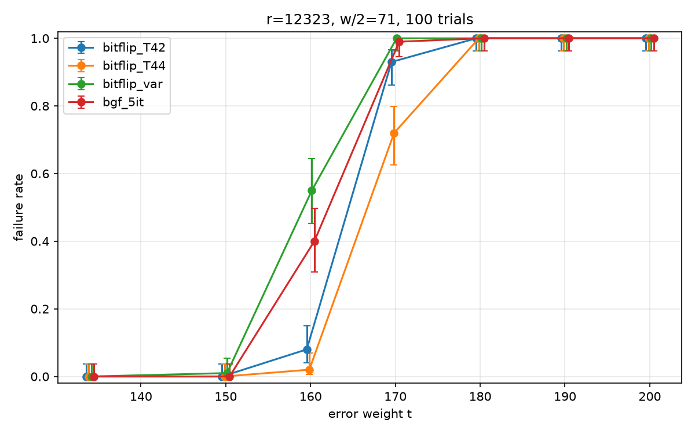

# BIKE Implementation and Timing Leaks

[](https://github.com/Synthettikk/BIKE_timing/actions/workflows/ci.yml)

This project aims to implement the BIKE cryptosystem without constant time and to demonstrate the occurrence of a timing leak using [dudect](https://github.com/oreparaz/dudect).
BIKE is a postquantum code-based cryptostem that made it to the round 4 of the NIST standardization competition. 
We also compare the Bit-Flipping algorithm and the Black-Gray-Flip decoder, and report an inventory of non constant functions that manipulate the secret : [report](docs/constant_time.md). 

The documentation we used can be found here : 
BIKE specification v4.2, <https://bikesuite.org/files/v4.2/BIKE_Spec.2021.07.26.1.pdf> (threshold function, BGF parameters).

## Status

| | |
|---|---|
| Circulant arithmetic in F₂[X]/(Xʳ − 1) (NTL) | done |
| Bit-flip decoder (fixed or variable threshold) | done |
| Black-Gray-Flip (BGF) decoder | done |
| Experiment harness and decoder comparison | done ([report](docs/decoder_comparison.md)) |
| Randomness and hashing (OpenSSL) | done
| KeyGen / Encaps / Decaps | done |
| Unit tests | done |
| Timing-leakage check with dudect | done ([report](docs/constant_time.md))|

> This implementation is not constant-time, not bit-exact with the
> BIKE specification (no KAT), does not properly clear the secrets from the
> memory and must not be used to protect real data.


## Results in brief

- **Decoders** ([docs/decoder_comparison.md](docs/decoder_comparison.md)):

At BIKE's error weight (t = 134), BGF decodes all 100 samples with 26% fewer
counters than bit-flipping with the same threshold function. Details, limits and
reproduction steps are in [docs/decoder_comparison.md](docs/decoder_comparison.md).
- **Timing** ([docs/constant_time.md](docs/constant_time.md)): a decapsulation takes about 7 ms.
  A failing decapsulation is about 1.3 ms (18 %) faster than a valid one, and the running time
  also depends on the ciphertext. A home-made dudect-style test and the dudect library agree.
- **Not fixed on purpose**: the leaks are measured and documented, not removed.

## Implementation notes

- **Representation.** A vector of length 2r is a pair $(v0, v1)$ of elements of
  $\mathbb{F}_2[X]/(X^r − 1)$, stored as NTL `GF2E`. The syndrome of an error $e$ is
  $s = e_0·h_0 + e_1·h_1$, with $h_0, h_1$ the first columns of the circulant blocks of $H$.
- **Counters.** The number of unsatisfied checks of position j is a cyclic
  correlation between the support of $h$ (71 ones) and the syndrome, computed over
  the integers. Using the sparse support costs about w·r operations per pass,
  instead of $2r^2$ with a dense matrix.
- **Decoders.** Parallel bit-flip (all counters on the same syndrome, then flip),
  with a fixed threshold or the BIKE threshold function of the syndrome weight, and
  BGF with 5 iterations and black/gray masked steps.
- **Evaluation.** All decoders are run on identical random samples. Cost is counted
  in counters computed, so the comparison does not depend on the machine or on NTL.
- **Randomness and hashing (OpenSSL).** Secrets (σ, the message m and the key
  generation seed) come from OpenSSL's CSPRNG (`RAND_priv_bytes`). The functions
  H, L and K are instantiated with SHAKE256 (OpenSSL's `EVP` interface) and a
  one-byte domain-separation tag. A deterministic stream `SHAKE256(tag ‖ seed)`
  feeds the fixed-weight sampler used for H(m) and for expanding the key generation
  seed, so decapsulation can re-derive the error exactly. `mt19937` is only used in
  `experiments/`, to keep the decoder comparisons reproducible, and never for keys.
  The sampler (Fisher-Yates with rejection sampling) is not constant-time.


## Installation

### Build

Requirements: a C++17 compiler, CMake ≥ 3.10, [NTL](https://libntl.org/), GMP and openSSL.

```bash
# Debian / Ubuntu / Linux Mint
sudo apt install build-essential cmake libntl-dev libgmp-dev libssl-dev

git clone https://github.com/Synthettikk/BIKE_timing
cd BIKE_timing

cmake -S . -B build        # configure (creates build/, Release mode by default)
cmake --build build -j     # compile everything
```

Executables are written to `build/`.

### Demo 

```bash
./build/bike_demo --fixed
```

Runs the whole KEM (key generation, encapsulation, decapsulation with the decoder's statistics,
implicit rejection, 20 round trips). With `--fixed` the seeds are fixed: everything except the
timings is reproducible, so the output below is what you should see.

```
== Parameters (BIKE level 1) ==
r = 12323, block weight d = 71 (w = 142), error weight t = 134, ell = 256 bits

== KeyGen ==
public key h: 1541 bytes, starts with 9709f8a60192d70b226f3475cd243a41...
secret key: h0 and h1 of weight 71 and 71, sigma of 32 bytes (not printed)
time: 12.6 ms

== Encaps ==
ciphertext: c0 = 1541 bytes, c1 = 32 bytes (total 1573)
shared secret (encaps): 57fda8a3a25f65383ef9dd05de2574876f8f8f4fe44f3d6fac3ad97e020a2649
time: 1.1 ms

== Decaps ==
syndrome s = c0 * h0: weight 4850 (out of 12323)
BGF decoder (5 iterations, no early exit): success
  syndrome reached 0 at iteration 2, final syndrome weight 0
  counters computed: 123290
  weight of the recovered error: 134 (t = 134)
shared secret (decaps): 57fda8a3a25f65383ef9dd05de2574876f8f8f4fe44f3d6fac3ad97e020a2649
keys match: yes
time: 10.9 ms

== Implicit rejection ==
c1 modified:  key 1b833c932d67a699... (different, no error reported)
c0 replaced:  key 3d43242ec7c59dbc... (different, no error reported)

== Round trips with fresh randomness ==
20/20 keys agree (0.2 s)
A decoding failure is negligibly rare with these parameters; one here would point to a bug.
```

### Run Experiments

#### Decoder comparison
```bash
./build/exp_bit_flip > results/bitflip_v2.csv  # bit-flip experiment (CSV on stdout)
./build/exp_bgf      > results/bgf_v1.csv      # BGF experiment
```

#### Timing decaps (homemade)
```bash
# tests: fixed_vs_random, fixed_vs_fixed2, random_vs_random, valid_vs_bad_c0, valid_vs_bad_c1
# usage: timing_decaps <test> <N> [raw_times.csv] > curve.csv
for t in fixed_vs_random fixed_vs_fixed2 random_vs_random valid_vs_bad_c0 valid_vs_bad_c1; do
  taskset -c 2 ./build/timing_decaps $t 10000 results/timing_${t}_times.csv > results/timing_${t}_curve.csv
done
```

#### Timing decaps with dudect
The same question with the reference library [dudect](https://github.com/oreparaz/dudect)
(vendored in `third_party/dudect/`, public domain). x86 Linux only: it reads the cycle counter.

```bash
# tests: fixed_vs_random, valid_vs_bad_c0, random_vs_random
# usage: dudect_decaps <test> [max number of batches of 500 measurements]
for t in fixed_vs_random valid_vs_bad_c0 random_vs_random; do
  taskset -c 2 ./build/dudect_decaps $t 200 | tee results/dudect_${t}.txt
done
```

It stops at the first leak (`|t| > 10`) or after the given number of batches. Each run draws a
new key, so the sign and size of `t` in `fixed_vs_random` vary from run to run. For clean
measurements pin the process to one core, keep the machine idle, and run one test at a time.
Results and discussion: [docs/constant_time.md](docs/constant_time.md).

The experiments take several minutes. Progress is printed on stderr, so the CSV stays clean.

### Tests

```bash
ctest --test-dir build --output-on-failure
```

### Plots (optional)

```bash
sudo apt install python3-pandas python3-matplotlib
# decoder comparison
python3 scripts/plot_results.py results/compare_v1.csv docs/figures 
# timing decaps
python3 scripts/plot_timing.py        # writes docs/figures/timing_decaps.png
```

See [docs/decoder_comparison.md](docs/decoder_comparison.md) for the analysis and how to reproduce it.

## Projet structure 

```python
BIKE_timing/
├── .github/                # CI GitHub Actions
│   └── workflows/
│       └── ci.yml
├── docs/
│   ├── figures/
│   │   ├── compare_v1_cost.png
│   │   └── compare_v1_failrate.png
│   └── decoder_comparison.md   # report
├── experiments/            #  decoder comparison etc
│   ├── dudect_decaps.cpp
│   ├── exp_bgf.cpp
│   ├── exp_bit_flip.cpp
│   ├── harness.cpp
│   ├── harness.h
│   └── timing_decaps.cpp  
├── include/
│   ├── crypto_rng.h        # os rng, hash functions, etc (openSSL)
│   ├── decoder.h           # bit_flip, bgf_decoder, threshold functions
│   ├── kem.h               # Keygen, Encaps, Decaps
│   ├── random_bike.h
│   └── utils.h             # GF2E_bike, Support, hamming_weight
├── results/                # raw CSV behind the report
│   ├── bgf_v1.csv
│   ├── bitflip_v1.csv
│   ├── bitflip_v2.csv
│   ├── compare_v1.csv
│   └── timing_*
├── scripts/
│   ├── plot_results.py     # CSV -> PNG
│   └── plot_timing.py
├── src/
│   ├── BIKE.cpp            #   main()
│   ├── crypto_rng.cpp 
│   ├── decoder.cpp
│   ├── kem.cpp             
│   ├── random_bike.cpp
│   └── utils.cpp
├── tests/                  # unit tests, run with ctest
│   ├── test_crypto_rng.cpp 
│   ├── test_decoder.cpp 
│   ├── test_kem.cpp 
│   └── test_tils.cpp
├── third_party/dudect/
│   └── dudect.h
├── .gitignore
├── CMakeLists.txt
├── LICENSE
└── README.md
```
