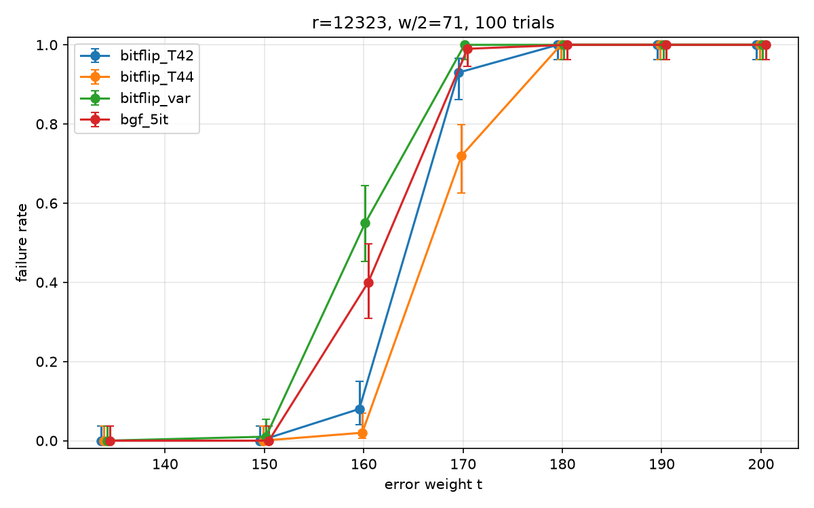

# BIKE Implementation and Timing Leaks

[](https://github.com/Synthettikk/BIKE_timing/actions/workflows/ci.yml)

This project aims to implement the BIKE cryptosystem without constant time and to demonstrate the occurrence of a timing leak using dudect.
BIKE is a postquantum code-based cryptostem that made it to the round 4 of the NIST standardization competition. 
We also compare the Bit-Flipping algorithm and the Black-Gray-Flip decoder, and report an inventory of non constant functions that manipulate the secret. 

The documentation we used can be found here : 
BIKE specification v4.2, <https://bikesuite.org/files/v4.2/BIKE_Spec.2021.07.26.1.pdf> (threshold function, BGF parameters).

## Status

| | |
|---|---|
| Circulant arithmetic in F₂[X]/(Xʳ − 1) (NTL) | done |
| Bit-flip decoder (fixed or variable threshold) | done |
| Black-Gray-Flip (BGF) decoder | done |
| Experiment harness and decoder comparison | done ([report](docs/report.md)) |
| Randomness and hashing (OpenSSL) | done
| KeyGen / Encaps / Decaps | done |
| Unit tests | done |
| Timing-leakage check with dudect | planned |
| Own GF(2)[X] arithmetic (replacing NTL) | planned |

> This implementation is not constant-time, not bit-exact with the
> BIKE specification (no KAT), does not properly clear the secrets from the
> memory and must not be used to protect real data.


## Results 

### Decoders comparison 



At BIKE's error weight (t = 134), BGF decodes all 100 samples with 26% fewer
counters than bit-flipping with the same threshold function. Details, limits and
reproduction steps are in [docs/report.md](docs/report.md).

### Timing leakage (dudect)

(In progress)

## Implementation notes

- **Representation.** A vector of length 2r is a pair $(v0, v1)$ of elements of
  $\mathbb{F}_2[X]/(X^r − 1)$, stored as NTL `GF2E`. The syndrome of an error $e$ is
  $s = e_0·h_0 + e_1·h_1$, with $h_0, h_1$ the first columns of the circulant blocks of $H$.
- **Counters.** The number of unsatisfied checks of position j is a cyclic
  correlation between the support of $h$ (71 ones) and the syndrome, computed over
  the integers. Using the sparse support costs about w·r operations per pass,
  instead of $2r^2$ with a dense matrix.
- **Decoders.** Parallel bit-flip (all counters on the same syndrome, then flip),
  with a fixed threshold or the BIKE threshold function of the syndrome weight, and
  BGF with 5 iterations and black/gray masked steps.
- **Evaluation.** All decoders are run on identical random samples. Cost is counted
  in counters computed, so the comparison does not depend on the machine or on NTL.
- **Randomness and hashing (OpenSSL).** Secrets (σ, the message m and the key
  generation seed) come from OpenSSL's CSPRNG (`RAND_priv_bytes`). The functions
  H, L and K are instantiated with SHAKE256 (OpenSSL's `EVP` interface) and a
  one-byte domain-separation tag. A deterministic stream `SHAKE256(tag ‖ seed)`
  feeds the fixed-weight sampler used for H(m) and for expanding the key generation
  seed, so decapsulation can re-derive the error exactly. `mt19937` is only used in
  `experiments/`, to keep the decoder comparisons reproducible, and never for keys.
  The sampler (Fisher-Yates with rejection sampling) is not constant-time.


## Installation

### Build

Requirements: a C++17 compiler, CMake ≥ 3.10, [NTL](https://libntl.org/), GMP and openSSL.

```bash
# Debian / Ubuntu / Linux Mint
sudo apt install build-essential cmake libntl-dev libgmp-dev libssl-dev

git clone https://github.com/Synthettikk/BIKE_timing
cd BIKE_timing

cmake -S . -B build        # configure (creates build/, Release mode by default)
cmake --build build        # compile everything
```

Executables are written to `build/`.

### Run

```bash
./build/main                                   # demo
./build/exp_bit_flip > results/bitflip_v2.csv  # bit-flip experiment (CSV on stdout)
./build/exp_bgf      > results/bgf_v1.csv      # BGF experiment
```

The experiments take several minutes. Progress is printed on stderr, so the CSV stays clean.

### Tests

```bash
ctest --test-dir build --output-on-failure
```

### Plots (optional)

```bash
sudo apt install python3-pandas python3-matplotlib
python3 scripts/plot_results.py results/compare_v1.csv docs/figures
```

See [docs/report.md](docs/report.md) for the analysis and how to reproduce it.

## Projet structure 

```python
BIKE_timing/
├── .github/                # CI GitHub Actions
│   └── workflows/
│       └── ci.yml
├── docs/
│   ├── figures/
│   │   ├── compare_v1_cost.png
│   │   └── compare_v1_failrate.png
│   └── report.md
├── experiments/            #  decoder comparison etc
│   ├── exp_bgf.cpp
│   ├── exp_bit_flip.cpp
│   ├── harness.cpp
│   └── harness.h
├── include/
│   ├── crypto_rng.h        # os rng, hash functions, etc (openSSL)
│   ├── decoder.h           # bit_flip, bgf_decoder, threshold functions
│   ├── kem.h               # Keygen, Encaps, Decaps
│   ├── random_bike.h
│   └── utils.h             # GF2E_bike, Support, hamming_weight
├── results/                # raw CSV behind the report
│   ├── bgf_v1.csv
│   ├── bitflip_v1.csv
│   ├── bitflip_v2.csv
│   └── compare_v1.csv
├── scripts/
│   └── plot_results.py     # CSV -> PNG
├── src/
│   ├── BIKE.cpp            #   main()
│   ├── crypto_rng.cpp 
│   ├── decoder.cpp
│   ├── kem.cpp             
│   ├── random_bike.cpp
│   └── utils.cpp
├── tests/                  # unit tests, run with ctest
│   ├── test_crypto_rng.cpp 
│   ├── test_decoder.cpp 
│   ├── test_kem.cpp 
│   └── test_tils.cpp
├── .gitignore
├── CMakeLists.txt
├── LICENSE
└── README.md
```
