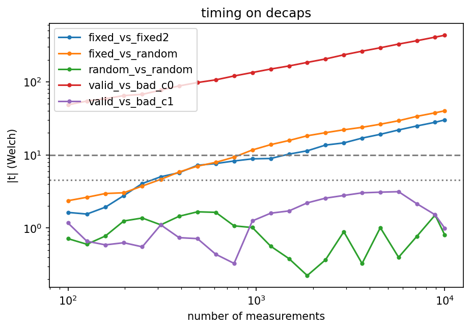

# Constant-time analysis

This implementation is **not constant-time**. It is educational code, and it says so on purpose.
This document lists, function by function, where execution time or memory access depends on
secret data, how serious each case is, and what a fix would look like. Measurements with
[dudect](https://github.com/oreparaz/dudect)-style tests are added in section 5 as they are made.

## 1. Scope and threat model

- **Attacker**: someone who can time a call to `decaps` (or `encaps`, `keygen`) many times, or who
  shares a CPU cache with the process. No fault injection, no power analysis.
- **Secrets**: the secret key `(h0, h1, sigma)`; the message `m` and the error `e = H(m)` in
  `encaps`; the decoded `m'` and `e'` in `decaps`. Everything in the ciphertext is public.
- **Out of scope**: the operating system, the compiler's choices (a `-O2` build may turn a
  branchless source into branches, or the reverse), microarchitectural attacks other than cache
  and timing.

Writing code in a style that is *meant* to be constant-time is necessary but not sufficient:
the property has to be checked on the compiled binary. That is the role of section 5.

## 2. Summary

Severity: **High** = leaks key material or the shared secret in a way known attacks can use;
**Medium** = leaks secret-dependent structure, no known practical attack on this exact code;
**Low** = leaks only public or already-known data.

| # | Where | What depends on the secret | Kind | Severity |
|---|-------|----------------------------|------|----------|
| 1 | `decaps`: `if (ok)` skips `hash_L` / `hash_H` on failure | whether decoding succeeded | branch, running time | High |
| 2 | `decaps`: `hash_K(ok ? m_dec : sk.sigma, ct)` | the decoding outcome, as a selection | branch / memory | Medium |
| 3 | `decoder`, `bgf_decoder`: `if (counts[j] >= T)` and the black / gray lists | counters computed from `H` and `e` | branch | High |
| 4 | `all_counters`, `counter_at`: `s_bits[(j + k) % r]` | `k` is a position of `h0` / `h1` | memory index | High |
| 5 | `bit_flip`, `flip_bit(j)`, `masked_iter` | positions of flipped bits (so of `e`) | memory index | Medium |
| 6 | `keygen_internal`: `InvModStatus` on `h0` | the secret `h0` | variable-time algorithm | High |
| 7 | `sample_distinct` / `uniform_int` (rejection loop, partial Fisher-Yates) | the sampled positions, number of rejections | loop count, memory index | High in `decaps` (samples `e'` from `m'`), Medium elsewhere |
| 8 | `GF2E_bike` constructors, `support()`, `to_bits` | secret supports | loop over secret indices | Medium |
| 9 | `GF2E_bike::to_bytes` | bit value of each coefficient (`if (IsOne(...))`) | branch | Medium (called on `e` in `hash_L`) |
| 10 | `operator==` (used in `decaps`) | position of the first difference | early exit | Medium |
| 11 | NTL multiplication (`mult`, `c0 * h0`, `pk.h * e1`) | operand values and weights | library, not audited | Unknown |
| 12 | Secrets are not wiped | key material stays in freed memory | memory hygiene | Medium |

## 3. Details

### 3.1 `decaps` (items 1, 2, 10)

On failure of the decoder, `decaps` does not compute `m'`, `L(e')` or `H(m')`, so a failed
decapsulation is *faster* than a successful one. This is exactly the information that implicit
rejection is designed to hide. For BIKE, whether decoding fails depends on the secret key, and
adaptive attacks that exploit decoding failures are known (Guo, Johansson, Stankovski, 2016).
A constant-time version computes `m'`, `H(m')` and the comparison on every call, using a
dummy value when decoding failed, and selects the key with a mask instead of `?:`.

`operator==` stops at the first different coefficient. Used on `H(m')` and `e'`, which are
secret, it leaks how long the common prefix is. It must become a full-length comparison that
accumulates the differences.

### 3.2 The decoder (items 3, 4, 5)

- The number of iterations is fixed (`N` or `NbIter`) and the function does not return early,
  which is the good part (see section 4).
- Inside an iteration, `if (counts[j] >= T)` branches on a counter that depends on `e`, so
  the *number* and the *positions* of the flips leak. A branchless version computes a mask from
  `counts[j] - T` and applies the flip with an XOR on every position.
- `all_counters` reads `s_bits[(j + k) % r]` where `k` runs over the support of `h0` and `h1`.
  The pattern of memory accesses reveals the support of the secret key to a cache attack. The
  usual remedy is to process the key as a dense bit vector with rotations whose access pattern
  does not depend on its value, at the price of more work.
- `masked_iter` and the black / gray lists build vectors whose length and content depend on
  the secret. The constant-time BGF decoder of Drucker, Gueron and Kostic works on bit masks
  of fixed size instead.

### 3.3 `keygen` (item 6)

`InvModStatus` is an extended Euclid algorithm; its running time depends on `h0`. For a
real implementation the inverse is computed with a fixed sequence of squarings and
multiplications (Itoh-Tsujii style, or Fermat's little theorem in the field part).

### 3.4 Sampling (item 7)

`uniform_int` rejects values until one falls in a uniform range, so the number of calls to
the XOF depends on the data. `sample_distinct` then accesses an array at the sampled indices.
In `decaps`, these functions run on `m'`, which is the secret message of a valid ciphertext:
timing and cache behaviour carry information about `e`, hence about `m` and the shared key.
Timing attacks on rejection sampling have been demonstrated on other KEMs (for example HQC),
so this is more than a theoretical concern. Fixes: sample with a fixed number of XOF
calls and a constant-time reduction, then sort / dedupe with a data-independent network or
a masked pass.

### 3.5 Conversions and library (items 8, 9, 11)

`to_bytes` and `to_bits` branch or loop on coefficient values; `support()` and the position
constructors loop over secret positions. These are mostly tied to the choice of NTL, whose
polynomial arithmetic makes no constant-time promise. Item 11 is listed as *unknown*, not as
*safe*: it has not been audited here, and dudect is the way to look for it.

### 3.6 Secret erasure (item 12)

Secret keys and intermediate values live in `NTL::GF2E`, `std::vector`, and `Bytes`,
all managed by allocators that do not wipe on free. `ShakeStream` does wipe its internal
buffer (`OPENSSL_cleanse`), but the key objects do not. Wiping needs either a zeroing
allocator for `Bytes` or a custom polynomial type; NTL's internal buffers are out of reach.

## 4. What is already fine

- **Fixed iteration count**: the decoders always run `N` / `NbIter` iterations and never exit
  early on success (success is only recorded).
- **`xor_bytes`**: fixed loop, no data-dependent branch.
- **SHAKE256** through OpenSSL: its running time does not depend on the input *value*, only on
  its length, which is public here.
- **Randomness** comes from the operating system (`RAND_priv_bytes`), not from a seeded
  generator, in `keygen` and `encaps`.

## 5. Measurements

### 5.1 Homemade 

Harness: `experiments/timing_decaps.cpp`, a test written for this project. One fixed
secret key; for each call a class (0 or 1) is drawn at random; the call to `decaps` is timed with
`clock_gettime(CLOCK_MONOTONIC)`; the two classes are compared with Welch's t-test, on all
measurements and on those below the 95th percentile ("cropped"). Reading rule: `|t| > 10` a
timing difference is almost certainly present, `|t| <= 4.5` none was found, in between is
inconclusive. A test that finds nothing proves nothing.

Conditions: Release build (`-O2`), one pinned core (`taskset -c 2`), nothing else running,
N = 10000 measurements per test, one run each. Machine: 
Intel(R) Core(TM) i7-9700K CPU. About 7.1 ms per call.
Each run generates a new key and new fixed ciphertexts, so the sign of `t` in the tests with
fixed inputs is not reproducible; the conclusions are.

| Test | Class 0 | Class 1 | Median 0 (µs) | Median 1 (µs) | t (raw) | t (cropped) |
|------|---------|---------|---------------|---------------|---------|-------------|
| `random_vs_random` (control) | fresh valid | fresh valid | 7150.8 | 7149.8 | 0.81 | 0.16 |
| `valid_vs_bad_c1` | fresh valid | one bit of `c1` changed | 7140.6 | 7140.0 | 1.00 | 0.64 |
| `fixed_vs_fixed2` | ciphertext A, repeated | ciphertext B, repeated | 7169.3 | 7193.0 | -22.0 | -30.1 |
| `fixed_vs_random` | one ciphertext, repeated | fresh valid | 7097.1 | 7129.8 | -36.0 | -40.1 |
| `valid_vs_bad_c0` | fresh valid | random `c0` (decoding fails) | 7152.9 | 5844.0 | 428.3 | 432.9 |

Reading:

- **Control**: two classes of fresh valid ciphertexts give `|t| < 1`, so the harness does not
  produce false positives.
- **Decoding failure is visible** (item 1): a failed decapsulation is 1.3 ms (18 %) faster,
  `t = 428`. The size of `t` grows like sqrt(N), as expected for a real difference. This test does
  not separate the skipped hashes from the different behaviour of the decoder on a random
  syndrome (items 3 and 5).
- **The running time depends on the ciphertext** (items 3, 5, 7, 11): two different valid
  ciphertexts, each repeated (so equally warm in the cache), differ by about 24 µs (0.3 %),
  `|t| = 22`. The cause is not identified. Isolating the decoder and `hash_H` is the next step.
- **Final comparison** (item 10): changing one bit of `c1` (decoding succeeds, the re-encryption
  check fails) gives `|t| = 1.0`. Nothing was detected; this does not show that
  `operator==` is constant-time, only that its effect is below what 10000 measurements resolve.

### 5.1 With dudect 

## 6. Mitigation roadmap

Ordered by effort for the gain:

1. Compute `m'`, `H(m')` and the comparison on every call; select the key with a mask
   (items 1, 2, 10). Small change, removes the most documented leak.
2. Full-length comparison for `operator==`, branchless `to_bytes` (items 9, 10).
3. Branchless thresholding in the decoder (item 3).
4. Own `GF(2)[X]` arithmetic with fixed-time multiplication and inversion (items 4, 6, 11),
   which also allows wiping secrets (item 12).
5. Constant-time sampling (item 7).

After each step, re-run section 5 and record the before / after values here.

## References

- Q. Guo, T. Johansson, P. Stankovski, *A key recovery attack on MDPC with CCA security using
  decoding errors*, ASIACRYPT 2016.
- N. Drucker, S. Gueron, D. Kostic, *QC-MDPC decoders with several shades of gray*, PQCrypto 2020.
- Q. Guo, T. Johansson, A. Nilsson, *A key-recovery timing attack on post-quantum primitives
  using the Fujisaki-Okamoto transformation and its application on FrodoKEM*, CRYPTO 2020.
- O. Reparaz, J. Balasch, I. Verbauwhede, *Dude, is my code constant time?*, DATE 2017.
