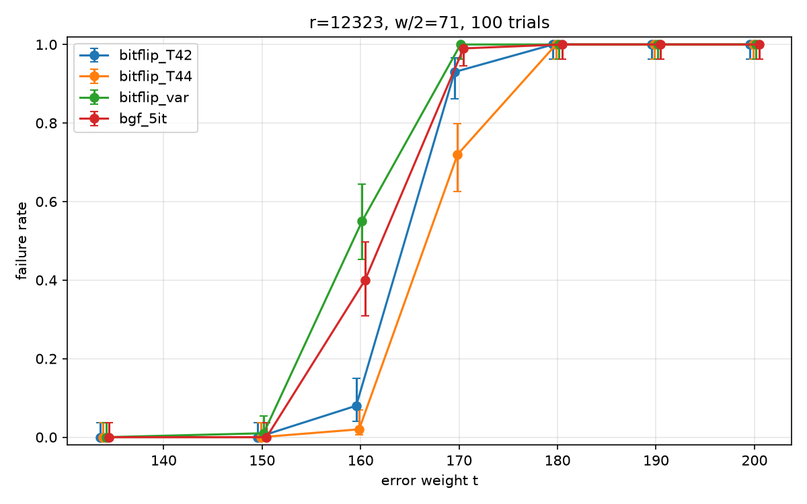
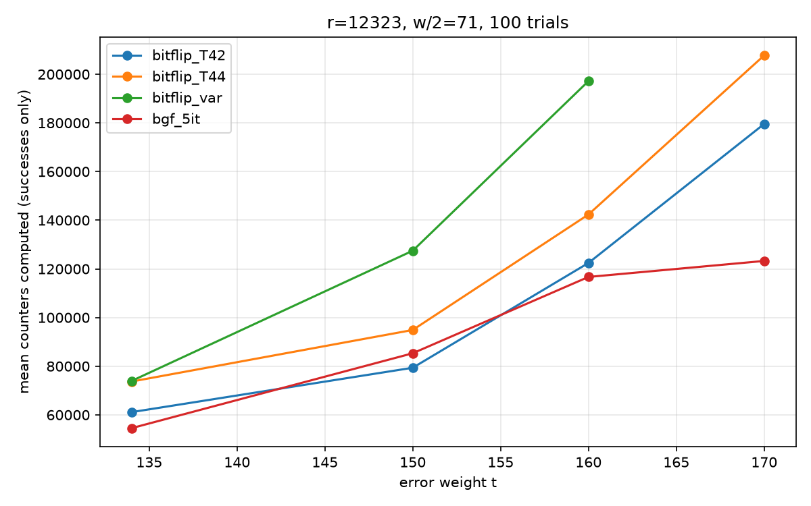

# Bit-flipping vs. Black-Gray-Flip on BIKE-sized QC-MDPC codes

This report compares a classic parallel bit-flipping decoder with the Black-Gray-Flip (BGF) decoder used by BIKE. All results come from the C++/NTL implementation in this repository, with the experiment harness in `experiments/`.

## 1. Conventions and decoders

**Code.** `R = F_2[X]/(X^r - 1)`, `n = 2r`, and `H = (H0 | H1)` is made of two circulant blocks. The polynomials `h0, h1` (weight `d = w/2` each) are the *first columns* of the blocks, so `H_b[i][j] = h_b[(i - j) mod r]`. For an error `e = (e0, e1)` of weight `t`, the syndrome is `s = e0·h0 + e1·h1` (a product in `R`).

**Counter.** For a position `j` and the current residual syndrome `σ = s + H·ê`, the counter is the number of unsatisfied parity checks that contain `j`: `c_j = #{ i : H[i][j] = 1 and σ[i] = 1 }`, computed over the integers (maximum `d`). A faulty position tends to have a high counter, a correct one a low counter, and the two distributions separate as `|σ|` decreases.

**Threshold.** Either a fixed `T`, or the BIKE threshold function of the specification (v4.2), a function of the syndrome weight `|σ|`:

```
T(|σ|) = max( floor(0.0069722 · |σ| + 13.530), 36 )
```

These constants are tuned by the BIKE team for `r = 12323`, `w = 142`, `t = 134` (security level 1), which is the parameter set used here.

**Bit-flip (BF).** At each iteration, compute all `n` counters on the same syndrome, flip every position with `c_j >= T`, then recompute `σ`. It always runs `N = 10` iterations (a fixed number of iterations, to avoid leaking the number of rounds through timing); we record the first iteration at which `σ = 0`.

**Black-Gray-Flip (BGF), 5 iterations, τ = 3.** Each iteration is a BF iteration with `T(|σ|)`, except that the first one also records two sets: *black* (flipped positions, `c_j >= T`) and *gray* (`T - τ <= c_j < T`). After the first iteration, two masked steps recompute the counters only on the black set, then only on the gray set, and flip the positions whose counter reaches `T' = (d+1)/2 + 1 = 37`. The masked steps use a low threshold, but only on a pre-selected set, so few correct positions are flipped.

## 2. Experimental setup

| | |
|---|---|
| Code | `r = 12323`, `w = 142` (`d = 71`), NIST level 1 |
| Error | uniform among the weight-`t` vectors of length `2r` (the weight per block is random) |
| Key | `h0, h1` drawn independently with exactly `d` ones each |
| Samples | 100 random `(H, e)` per `t`, **identical for all decoders** (fixed seed 1234) |
| Success | the decoder returns exactly `e` |
| BF | `N = 10`, thresholds `T ∈ {39, 42, 44, 46, 48}` and the variable threshold |
| BGF | `NbIter = 5`, `τ = 3`, variable threshold |
| Cost | number of counters computed (machine independent), averaged over successful decodings |

A first run (200 trials, `t ∈ {134, 140, 146, 152}`, fixed `T ∈ {33, 36, 39, 42}`) was used to locate the useful range of `T`. Failure rates are given with 95% Wilson intervals: **0 failures out of 100 only means a rate below about 3.7%.**

## 3. Results

### 3.1 Failure counts (out of 100 trials)

| t | T=39 | T=42 | T=44 | T=46 | T=48 | BF, variable T | BGF |
|---|---|---|---|---|---|---|---|
| 134 | 57 | 0 | 0 | 0 | 23 | 0 | 0 |
| 150 | 100 | 0 | 0 | 2 | 100 | 1 | 0 |
| 160 | 100 | 8 | 2 | 69 | 100 | 55 | 40 |
| 170 | 100 | 93 | 72 | 100 | 100 | 100 | 99 |
| 180–200 | 100 | 100 | 100 | 100 | 100 | 100 | 100 |



*Failure rate versus `t` for `bitflip_T42`, `bitflip_T44`, `bitflip_var` and `bgf_5it`, with 95% Wilson intervals (points are slightly shifted horizontally for readability).*

### 3.2 Cost (mean counters computed, successes only)

| t | T=42 | T=44 | BF, variable T | BGF |
|---|---|---|---|---|
| 134 | 61.1k | 73.7k | 73.9k | **54.5k** |
| 150 | **79.4k** | 94.9k | 127.5k | 85.3k |
| 160 | 122.4k (92 succ.) | 142.3k (98) | 197.2k (45) | 116.7k (60) |



*Mean counters computed versus `t`, successful decodings only; a curve stops where a decoder has no success.*

A full pass over the `n = 24646` counters is the unit of cost, so one BF iteration costs 24,646. Mean iterations to success at `t = 134`: 2.48 (T=42), 2.99 (T=44), 3.00 (variable T), 2.21 (BGF).

## 4. Analysis

**Fixed threshold.** At `t = 134`, BIKE's own error weight, a fixed threshold works only inside a narrow window. In the first run (200 trials), `T = 33` and `T = 36` failed on every trial with a final syndrome weight of about `r/2 = 6161` (the decoder diverges: too many correct bits are flipped). `T = 39` is on the edge: it fails on 57% of the 100 trials of the main run (67% over the 200 trials of the first run). `T = 42–46` never fails, and `T = 48` fails on 23% of the trials with a final syndrome weight around 3,000, i.e. partial progress only. The best fixed value is also not stable across `t`: the useful window closes from `T = 42–46` at `t = 150` to `T = 44` alone at `t = 160`.

**Variable threshold.** The BIKE threshold function, whose constants are calibrated for `t = 134`, reaches 0 failures at `t = 134` without per-`t` tuning, at the price of about 20% more counters than `T = 42` (73.9k vs 61.1k). The value `T = 42` was chosen after the fact among several candidates, while the variable threshold is not tuned. Beyond `t = 134` the constants are no longer calibrated: the initial syndrome weight grows with `t` (about 5,200 at `t = 160`), the first threshold becomes too high (49–50), almost nothing is flipped, and the decoder stalls close to its initial syndrome weight instead of converging. This is why it falls behind a hand-tuned fixed `T` at `t = 160` (55 failures vs 2 for `T = 44`).

**BGF.** At `t = 134` and `t = 150` BGF never fails (0 out of 100) and needs 26% and 33% fewer counters than bit-flipping with the same threshold function (54.5k vs 73.9k, and 85.3k vs 127.5k). The masked steps are almost free (about 25–65 counters per decoding on average, against 24,646 for a full pass), so the gain comes entirely from needing fewer iterations (2.21 vs 3.0 at `t = 134`). The cost also grows more slowly with `t` than for the variable-threshold BF (+56% vs +72% from `t = 134` to `t = 150`). Compared with the hand-picked `T = 42`, BGF is 11% cheaper at `t = 134` but 7% more expensive at `t = 150`, so the advantage is mostly that BGF needs no per-`t` tuning. At `t = 160`, BGF fails on 40% of the trials (95% interval 31–50%) against 55% (45–64%) for the variable-threshold BF: the intervals overlap, so this is weak evidence, and both are far from `T = 44` (2%, interval 0.6–7%). The failures of BGF at `t = 160` end with a lower final syndrome weight than those of BF (about 2,800 vs 4,800), and its successes already use 4.7 of the 5 iterations on average, so some of them may be limited by `NbIter`.

## 5. Limits

- The constants of the threshold function are calibrated for `t = 134` only. Experiments with `t > 134` therefore measure mostly the quality of this calibration, not the decoding algorithm itself.
- Cost is averaged over successes, and the sets of successes differ between decoders when `t >= 160` (for example 45 vs 60 samples). Cost figures at `t = 160` are indicative only, and BGF is capped at 5 iterations.
- Failure rates below about 3.7% cannot be resolved with 100 trials, and the decoding failure rate targeted by BIKE (2^-128) cannot be measured by direct simulation. This study shows relative behavior, not security-level failure rates.
- The arithmetic relies on NTL, which is not constant-time, and the decoder branches on counter values: the implementation is educational and leaks through timing.
- BF runs `N = 10` iterations and BGF `NbIter = 5`, as in the BIKE specification; the iteration budgets are therefore different. A `bgf_10it` run at `t = 160` would tell whether the 40 failures are limited by `NbIter`.

## 6. Reproducing the results

```
cmake -S . -B build
cmake --build build --target exp_bit_flip exp_bgf
./build/exp_bit_flip > results/bitflip_v2.csv
./build/exp_bgf      > results/bgf_v1.csv

(cat results/bitflip_v2.csv; tail -n +2 results/bgf_v1.csv) \
    | grep -E "^r,|T42|T44|var|bgf" > results/compare_v1.csv
python3 scripts/plot_results.py results/compare_v1.csv
```

Parameters: seed 1234, 100 trials, `t ∈ {134, 150, 160, 170, 180, 190, 200}`, BF with `N = 10`, BGF with `NbIter = 5` and `τ = 3`. The first run (200 trials, `t ∈ {134, 140, 146, 152}`) is in `results/bitflip_v1.csv`.

## References

- BIKE specification v4.2, <https://bikesuite.org/files/v4.2/BIKE_Spec.2021.07.26.1.pdf> (threshold function, BGF parameters).
- N. Drucker, S. Gueron, D. Kostic, *QC-MDPC Decoders with Several Shades of Gray*, PQCrypto 2020, <https://doi.org/10.1007/978-3-030-44223-1_3> (Black-Gray-Flip).
- N. Drucker, S. Gueron, D. Kostic, *On Constant-Time QC-MDPC Decoders with Negligible Failure Rate*, CBCrypto 2020, <https://doi.org/10.1007/978-3-030-54074-6_4>.
